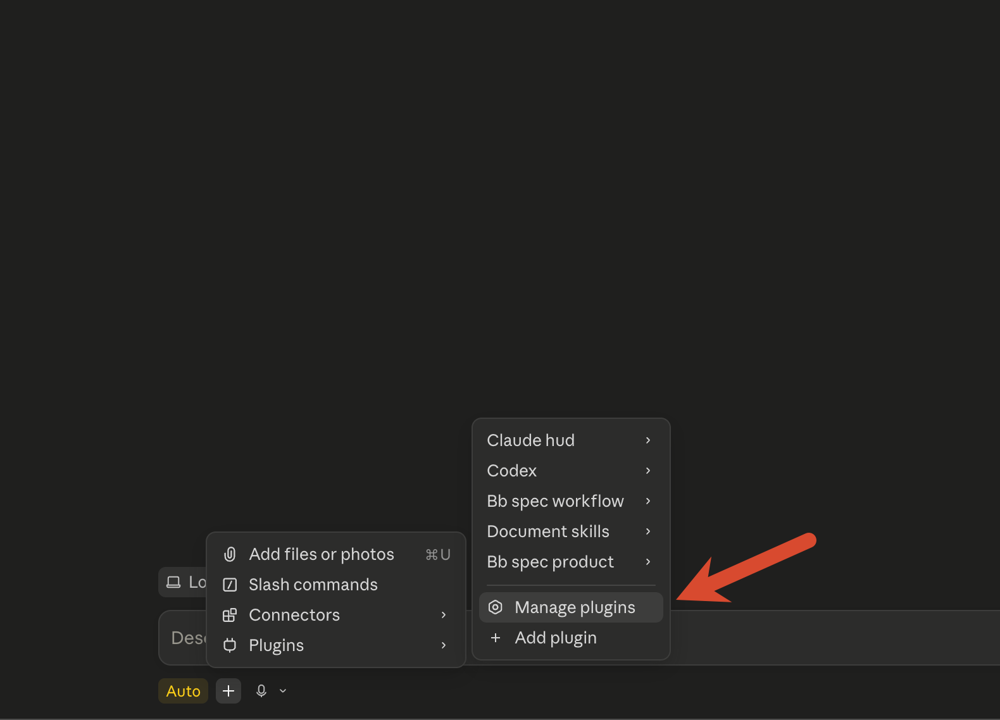
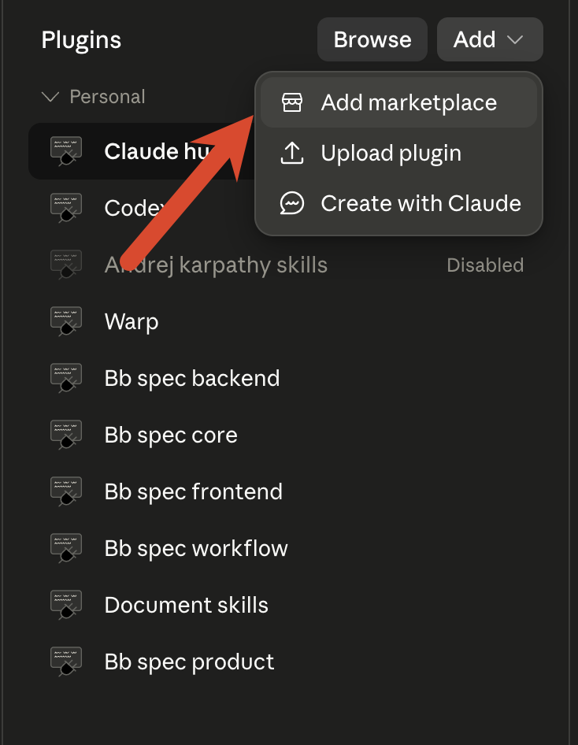
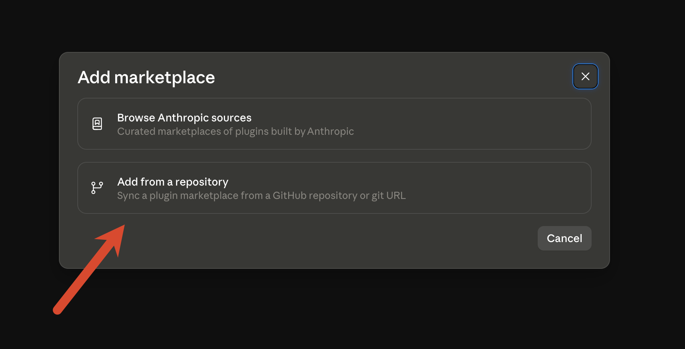
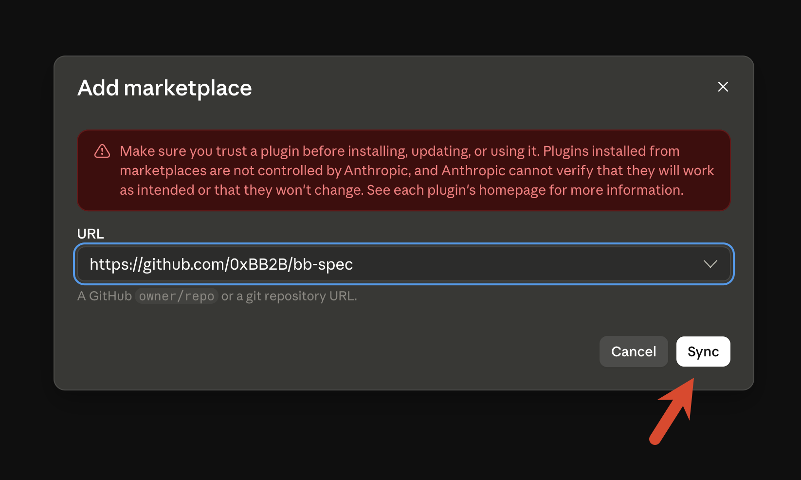
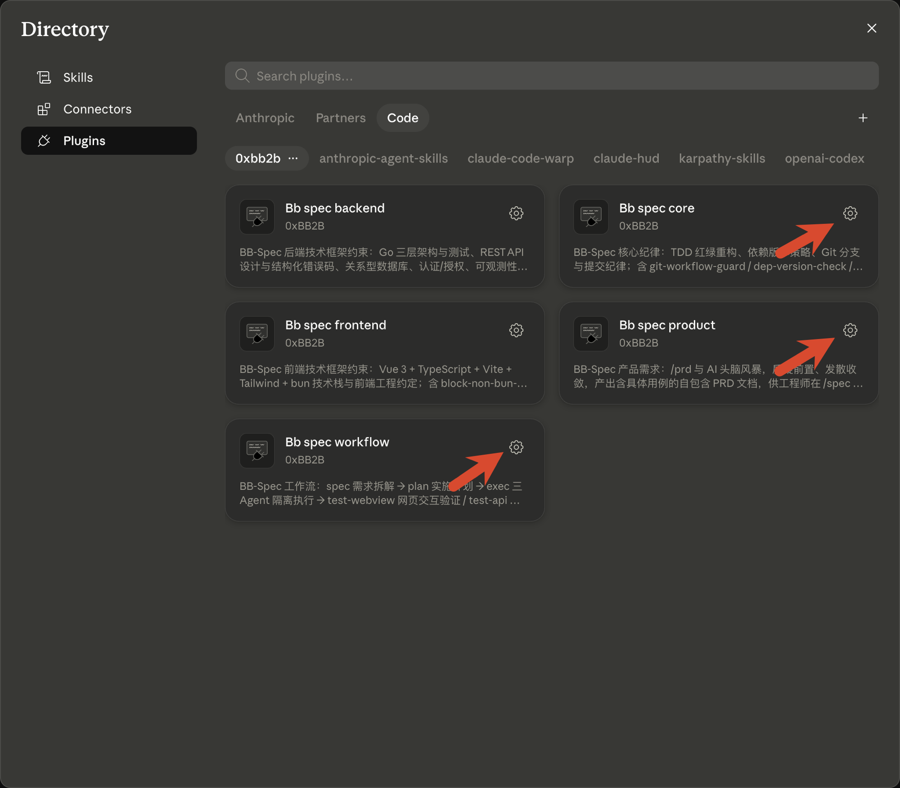
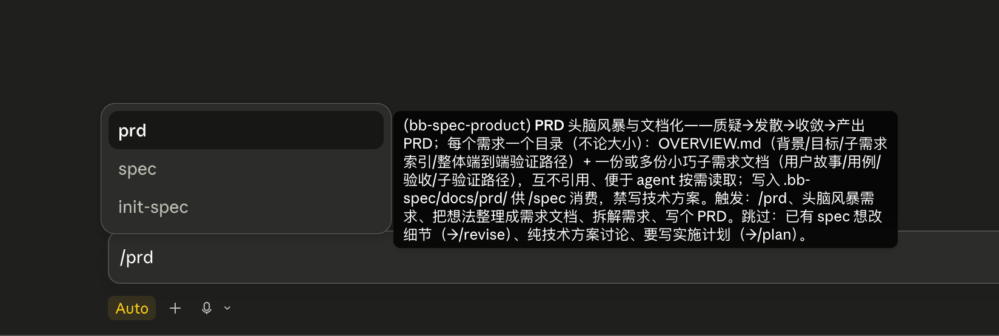

<p align="center">
  
</p>

<h1 align="center">📐 BB-Spec</h1>

<p align="center">
  <strong>曖昧な要件を出荷可能なコードまで運ぶ、PRD 駆動の Claude Code パイプライン。</strong>
</p>

<p align="center">
  各ステージはトレース可能・再開可能・敵対的に検証済み —— Go / Vue + bun / TDD / Git 規律のスタック制約スイート付き。
</p>

<p align="center">
  <a href="https://github.com/0xBB2B/bb-spec/actions/workflows/ci.yml?query=branch%3Amain"></a>
  <a href="https://github.com/0xBB2B/bb-spec/releases"></a>
  <a href="https://github.com/0xBB2B/bb-spec/stargazers"></a>
  <a href="LICENSE"></a>
  <a href="https://docs.anthropic.com/en/docs/claude-code/overview"></a>
</p>

<p align="center">
  <a href="./README.md">English</a> · <a href="./README.zh.md">简体中文</a> · <a href="./README.zh-TW.md">繁體中文</a> · <strong>日本語</strong> · <a href="./README.ko.md">한국어</a>
</p>

<p align="center">
  <a href="#-30-秒で開始">クイックスタート</a> ·
  <a href="#-コアパイプライン-prd--ship">パイプライン</a> ·
  <a href="#-ステージ一覧">ステージ</a> ·
  <a href="#-付属の制約-skills">制約 Skills</a> ·
  <a href="#-claude-code-インストール--install">インストール</a> ·
  <a href="#-デフォルトで有効な-hooks">Hooks</a> ·
  <a href="#-設計の系譜先行事例と比較">設計の系譜</a>
</p>

---

## 🚀 30 秒で開始

```bash
/plugin marketplace add 0xBB2B/bb-spec
/plugin install bb-spec-core@0xbb2b
/plugin install bb-spec-workflow@0xbb2b
```

メインパイプラインの 5 コマンド:

| コマンド | 何をするか | いつ使うか |
|---|---|---|
| `/prd` | 質疑→明確化→分解、1 回の承認で PRD + AGENTS.md を書き出し、plan → exec を自動実行 | 新規要件の着手時 |
| `/plan` | PRD → 関数レベルの実装計画、完了後に exec を自動実行 | `/prd` から自動呼び出し |
| `/exec` | 3 エージェント隔離で Test→Impl→Review を実行、仕上げに doc-update を自動実行 | `/plan` から自動呼び出し;中断時は手動で再開 |
| `/review` | 並列 finder + 敵対的検証 | PR 提出前 |
| `/git-push` | pre-review セルフチェック + push + PR 作成 | リリース準備時 |

いつでも介入可能な 4 つの支線:`/git-clone`(リモートプロジェクトをローカルに取得 + `.bb-spec.yaml` を生成するワンショット onboarding)、`/revise`(あらゆる逸脱を根本原因に基づき正しいステージに戻す)、`/doc-update`(ドキュメントとコードの一貫性チェック;`/exec` と `/revise` の終了時には今回の変更範囲を自動で一度実行)、`/prd-migrate`(spec を使っていた旧プロジェクトのワンショット移行)。

---

## 🔁 コアパイプライン `prd → ship`

```
 (任意) /git-clone ──► リモート取得 + .bb-spec.yaml 生成
   │
 /prd ══► /plan ══► /exec ══► /doc-update ──► /review ──► /git-push
 何を作るか どう作るか Red→Green  ドキュメントをコードに追従  並列+敵対  pre-review+PR 作成
 (唯一の承認)          →Review
 ══► 自動で接続、再確認なし(新規第三者依存の追加や設計判断が必要な時のみ停止)
                                                          │
        ┌─────────────────────────────────────────────────┘
        │
        ▼ /revise(いつでも介入、根本原因でルーティング)
          PRD 欠陥 → 本ブランチの PRD を修正   ·   実装ドリフト → TDD で修正   ·   大きな要件変更 → /prd

 (任意) /test-webview · /test-api — フロント / バックエンド e2e、/exec と /review の間に挿入
 /doc-update(定期 / 必要時) — ドキュメントとコードのドリフト走査 → デフォルトはドキュメントを更新、
                                  コードがプロジェクト制約に違反する場合のみ止まって確認 → /revise へルーティング
```

**このパイプラインが信頼できる理由** —— すべての受け渡しが**ディスク上のファイル**であり、チャット内の一時記憶ではない。これが再開可能・AI 交代可能・端から端までトレース可能な根本である。

### 🎯 ステージ一覧

- **`/git-clone`** — *ワンショット onboarding*:リモートリポジトリをローカルに取得し `.bb-spec.yaml` を書き出す。
  - **AskUserQuestion 2 連発**:① 単一リポ / マルチリポワークスペース(ディレクトリ構造を決定) ② `base_dir`(以降すべての bb-spec 成果物の配置を決定)
  - **マルチリポワークスペース**は共通の親ディレクトリを作り各メンバーリポジトリを個別に clone(ビルドツールが期待する相対配置を復元)、ネスト禁止・上書き禁止
  - 責務を厳格に絞る:**コード取得 + `base_dir` 書き込みのみ**、コードは読まず・依存もインストールしない

- **`/prd`** — 新規要件の唯一の入口、**「何を作るか・なぜ作るか」**に答える。
  - 質疑前置(結論が「やる価値なし」でも可)→ 段階的明確化 → 分解、全工程を **plan モードで読み取り専用の整合**;ユーザーの**承認はこの 1 回だけ**、以降 `/plan` → `/exec` → `/doc-update` を自動で最後まで実行
  - **PRD**(`docs/prd/<日付>.<テーマ>/`:背景、目標、非目標、ユーザーストーリー、テスト可能な制約と受け入れ基準、決定記録)と **AGENTS.md**(プロジェクト全体に効く制約、例:「ジェネリクス禁止」)を書き出す
  - PRD は本ブランチ内では変更可(実装中に方針の問題が見つかれば直接修正)、マージ後は凍結;**コードが「今どう動くか」の唯一の情報源**、PRD は「なぜ」だけに答える
  - 以降の各 commit に `Requirement: <PRD ディレクトリ名>` マーカーを付与:`git log -L :関数:ファイル` でその関数を変更した要件を一覧でき、対応する PRD の決定記録を読めば当時の設計理由がわかる

- **`/plan`** — PRD → 自己完結型・**関数レベル**の実装計画、**「どう作るか」**に答える。
  - 1 ファイル 1 独立問題、関数名と責務まで詳細化;宣言的成果物(DDL / API 契約 / 設定)は**最終成果物を直接インライン**、exec がそのまま書き出す
  - `/prd` から自動呼び出し、個別の承認は不要;**新規第三者依存の追加**が必要な時だけ止まってユーザーの同意を求め、同意は version-policy が要求する承認とみなす
  - plan は実行中だけ存在し、全完了後に `/exec` が削除 —— PRD との重複を避ける

- **`/exec`** — **3 エージェント隔離実行**、不正対策のコア設計。
  - *Test* エージェントは PRD の制約のみ読んで失敗テストを書く(Red)
  - *Impl* エージェントは **PRD を見ない**、テスト + 関数リストのみ見て実装を書く(Green)、「意図に合わせて不正」できない;新規追加の第三者ライブラリは plan で承認された依存リストに制限
  - *Review* エージェントは PRD の受け入れ基準と AGENTS.md に照合し、堅牢性/セキュリティの観点でもチェック、読み取り専用
  - 各ステップの進捗を `PROGRESS.md` に記録、token 枯渇でも**ロスレス再開**可能
  - 実装中に方針の問題が見つかったら止まって選択を求める:コードを直す / 今回の PRD を直す / 一時停止;小さな変更はその場で修正、大きな変更は `/prd` に戻って再承認
  - 全完了後に `/doc-update` の仕上げモードを自動実行、今回の PRD と README などのドキュメントを実際の成果物に追従させる

- **`/test-webview`** — フロントエンド / ウェブプロジェクトの**インタラクション受け入れ**。
  - Docker フルスタック起動(初回確認後に記憶、終了後 `down -v` でクリーンアップ)、ブラウザ MCP で実ブラウザを駆動
  - **各ケースに隔離されたシリアルサブエージェントを割り当て**、数百ケースでもメインコンテキストを溢れさせない;全工程シリアル(ブラウザ単一インスタンス)
  - ケースは本ブランチの PRD の受け入れ基準と検証パスから自動生成(マージ済みの過去 PRD は読まない);実行前に**カバレッジ整合**、ギャップを暗黙に見逃さない;失敗は `/revise` へ
  - ブラウザ MCP(playwright / chrome-devtools)が必要

- **`/test-api`** — バックエンド**API e2e**。
  - `compose.e2e.yaml` でフルスタック起動、md ケースを**機械的に単一ファイルの Bun TS runner にレンダリング**、`bun run` で一発実行
  - **サブエージェントゼロ、並列ゼロ** —— HTTP は決定的スクリプト、時計状態は共有のため並列禁止
  - **時間依存ルール**(token 期限切れ、注文タイムアウト、ポイント期限)は `/test/advance-time`、`/test/backdate`、`/test/trigger-job` プロトコルでテスト
  - アプリ側は**2 つのイメージを出力**:test イメージは `/test/*` ルート + `ENV TESTAPI=1` 搭載;本番イメージは `/test/*` ソースを**物理的に除外**;`/test/healthz` プローブが失敗したら中断、フォールバック禁止

- **`/review`** — Workflow オーケストレーション、**敵対的検証**付きのローカル PR review。
  - フェーズ 1 で diff を ≤1500 行ごとに分割し、各スライスの diff を一度だけディスクに書き出して全 agent で共有、各スライスに **3 つの finder** を並列実行:欠陥(セキュリティ / 堅牢性 / 正確性)/ 設計(品質 / 簡潔性 / ドキュメント同期)/ **Codex クロスモデル独立** review、schema 強制で構造化
  - フェーズ 2 で各スライスに **1 つの懐疑的仲裁者**を割り当て、そのスライス内の全 🔴/🟡 を三視点(重要性 / 根本原因性 / 未修正リスク)で判定、多数決で残否を決定
  - フェーズ 3 で各スライスに **1 つの走査者**を割り当て、確認済み全項目の**同種の兄弟箇所**をそのスライス内で走査、`/revise` で一クラスまとめて修正;NIT は一括処理可能
  - 全フェーズがスライス単位で agent を派遣するため、コストは diff 1 行あたり約 300 tokens(15k 行の diff ≈ 50 agent / 5M tokens)
  - 修正が入った後、修正 diff を**自動で 1 回再レビュー**;レポートは `.bb-spec/.cache/review/` に保存され、次回実行時に再発の検出と却下済み項目のスキップに使われる
  - 読み取り専用、絶対に自動編集しない;Claude Code ≥ 2.1.154 が必要

- **`/revise`** — いつでも介入可能な例外処理。
  - まずコードを読んで現状を確認し、`git log -L` で関連 PRD を辿ってから、逸脱を**根本原因で 3 分類**:*PRD 欠陥*、*実装ドリフト*、*要件変更*
  - 本ブランチの PRD は変更可;マージ済み PRD は変更せず、修正理由を commit 本文に書く
  - 修正が必要なすべての review 指摘はここに集約
  - 修正後に `/doc-update` の仕上げモードを自動実行

- **`/git-push`** — ユーザートリガーの push + PR フロー(単一 / マルチリポジトリ)。
  - AGENTS.md または本ブランチの PRD がある場合、まず**ブランチ規範セルフチェック(pre-review)**を実行:サブエージェントがプロジェクト制約と PRD vs ブランチ diff を比較、違反を反復修正
  - PR 説明に `Requirement:` マーカーを付与;squash マージは「PR タイトルと説明」または「PR タイトルと commit 詳細」に設定する必要あり、さもないとマーカーが失われる
  - **6 セクションの PR 説明**(背景 / 要件 / アプローチ / 結果 / テスト / 規範、< 50 行)を起草、そのまま PR body として使用

- **`/doc-update`** — ドキュメントとコードの**一貫性チェック**。
  - 4 種類の検出:doc-stale(ルートドキュメントの陳腐化)/ prd-stale(本ブランチの PRD と成果物の不一致)/ code-violation(コードが AGENTS.md に違反)/ agents-conflict(プロジェクト制約同士の矛盾)
  - **コードが真実、ドキュメントはコードに合わせる**;コード変更は必ず先に確認し、`/revise` 経由で TDD へ;マージ済みの PRD はどのモードでも触らない
  - **仕上げモード**(`--tail`):`/exec`・`/revise` の終了時に自動呼び出し、本ブランチの変更範囲だけを扱う

- **`/prd-migrate`** — spec を使っていた旧プロジェクトの**ワンショット移行**。
  - 元の PRD はそのまま `prd/` に戻し、spec は領域ごとに legacy PRD へ変換;`commits:` に関連 commit ハッシュを記録し、古いコードも git から PRD へ逆引き可能
  - 出典のある内容だけを書き、各設計理由に出典を付記、見つからなければ「不明」としてユーザーに確認、**AI に捏造させない**;プロジェクト単位の制約は AGENTS.md へ移す

**同梱されるもの**

- **8 個のオーケストレーションサブエージェント**(上記ステージに駆動される):`test-engineer` / `impl-engineer` / `prd-reviewer` / `webview-test-runner` / `review-defect` / `review-design` / `review-codex` / `pre-reviewer`
- **4 つの受動 hook**(自動発動):npm/yarn ブロック、main コミットブロック、依存バージョンセルフチェック、Stop 時の 4 項目セルフチェック

---

## 🧩 付属の制約 Skills

上記のパイプラインにルールを供給する —— 必要なレイヤーのみインストール。

### bb-spec-core — 汎用規律

- **`tdd-workflow`** — Red-Green-Refactor 規律、追加 / 修正 / 削除 3 シナリオの標準フローをカバー
- **`version-policy`** — 標準 / 公式ライブラリ優先、新規第三者ライブラリ導入はユーザーの明示的同意が必要(`/plan` 段階でユーザーが同意した依存リストは同意とみなす);バージョン固定前に依存の公式最新版を確認、訓練記憶に頼ることを禁止
- **`git-workflow`** — ブランチ決定、段階的 commit、6 セクション PR 説明、マージ後クリーンアップ

### bb-spec-backend — バックエンドスタック制約

- **`golang-constraints`** — Go のフルライフサイクル:3 層アーキテクチャ、過剰抽象禁止、テストは本番設計に従属
- **`golang-testing`** — Go テスト構成:table-driven、subtests、benchmark、fuzz
- **`api-design`** — REST 設計:リソース命名、ステータスコード、ページネーション、`A-BBB-CCCC` 構造化エラーコード
- **`database-constraints`** — アプリ層 UUIDv7 主キー、ソフトデリート + 複合 UNIQUE、DB 管理タイムスタンプ、エンドツーエンド UTC
- **`auth-constraints`** — 認証(authN):デュアル token(JWT + 不透明 refresh)ローテーション + リプレイ検出、スライディング有効期限、argon2id
- **`authz-constraints`** — 認可(authZ):デフォルト拒否、判定集中、粗粒度ロール + 細粒度リソース ownership の 2 段階チェックで IDOR 防止
- **`observability-constraints`** — ログ / トレース / メトリクスを OTel ベースで:一度組み立て、構造化 JSON + 安定 trace_id、ラベル基数制限
- **`service-constraints`** — ランタイムガバナンス:env 注入シークレットの fail-fast、グレースフルライフサイクル、書き込み冪等性、タイムアウト + 安全なリトライ
- **`config-constraints`** — 設定キャリアの 3 分類:env/secret は起動必須かつホット更新不可、yaml/configmap はホット更新可能なデフォルト値、DB は動的ビジネス設定;コア認証情報は secret/KMS のみ、DB に降ろす場合は envelope encryption 必須

### bb-spec-frontend — フロントエンドスタック制約

- **`vue-constraints`** — Vue 3 + TypeScript + Vite + Tailwind + bun スタック強制制約
- **`frontend-constraints`** — エンジニアリング規約:統一リクエスト client、エラーコード→UI マッピング集中、UX のみのルートガード、契約由来の型

---

## 📦 Claude Code インストール / Install

BB-Spec は**4 つの独立インストール可能なサブ plugin** に分割 —— 必要な制約レイヤーのみインストール。

まず一度 marketplace を追加(Claude Code 内で実行):

```bash
/plugin marketplace add 0xBB2B/bb-spec
```

次に必要なレイヤーをインストール:

| サブ plugin | 何が手に入るか | インストールコマンド |
|---|---|---|
| **bb-spec-core** _(推奨ベース)_ | TDD / バージョンポリシー / Git 規律 + 3 つの受動 hook | `/plugin install bb-spec-core@0xbb2b` |
| **bb-spec-workflow** _(コア機能)_ | prd → plan → exec → doc-update → review → revise → git-push(+ 任意 test-webview / test-api e2e)、git-clone ワンショット初期化、prd-migrate 旧プロジェクト移行 + 8 サブエージェント | `/plugin install bb-spec-workflow@0xbb2b` |
| **bb-spec-backend** | Go / REST API / DB / 認証 / 認可 / 可観測性 / サービスガバナンス / 設定制約 | `/plugin install bb-spec-backend@0xbb2b` |
| **bb-spec-frontend** | Vue 3 + TS + Vite + Tailwind + bun スタック & エンジニアリング規約(bun hook 付き) | `/plugin install bb-spec-frontend@0xbb2b` |

必要に応じて選択 —— 例えば規律とワークフローのみでスタック意見なし:`bb-spec-core` + `bb-spec-workflow`;フルセット:4 つすべて。

または `~/.claude/settings.json` に手動追加(必要なものだけ enable):

```json
{
  "extraKnownMarketplaces": {
    "0xbb2b": {
      "source": { "source": "github", "repo": "0xBB2B/bb-spec" }
    }
  },
  "enabledPlugins": {
    "bb-spec-core@0xbb2b": true,
    "bb-spec-workflow@0xbb2b": true,
    "bb-spec-backend@0xbb2b": false,
    "bb-spec-frontend@0xbb2b": false
  }
}
```

### Claude Code デスクトップアプリでのインストール(スクリーンショット付き)

Claude Code デスクトップアプリ(Mac / Windows)向け。すべて GUI 操作で完結し、コマンド入力は不要。

**1. プラグイン管理パネルを開く**

入力欄の `+` → `Plugins` → `Manage plugins`:

<p align="center">
  
</p>

**2. marketplace を追加**

Plugins パネル右上の `Add` → `Add marketplace`:

<p align="center">
  
</p>

**3. リポジトリから追加を選択**

ダイアログで `Add from a repository` を選択:

<p align="center">
  
</p>

**4. bb-spec のリポジトリ URL を入力して同期**

URL に `https://github.com/0xBB2B/bb-spec` を入力し、`Sync` をクリック:

<p align="center">
  
</p>

**5. コア 2 点セットを有効化**

Directory に bb-spec の 4 つのサブプラグインが表示される。`Bb spec core` / `Bb spec workflow` の 2 つのカード右上の歯車アイコンをクリックして有効化(backend / frontend は必要に応じて):

<p align="center">
  
</p>

**6. インストールを確認**

入力欄に戻り、`/prd` と入力。コマンド補完が表示されればインストール成功:

<p align="center">
  
</p>

## 🔄 バージョンと更新 / Versioning

```bash
/plugin update                  # インストール済みすべての plugin をチェックし更新
/plugin update bb-spec-core     # 特定のサブ plugin のみ更新
```

4 つのサブ plugin は単一の同期されたバージョンラインを共有。

---

## 🪝 デフォルトで有効な Hooks

各 hook は「その関心事を担当するサブ plugin」と一緒に配布 —— 対応する plugin をインストールして初めて利用可能。

| Hook | 所属サブ plugin | トリガータイミング | 効果 |
|---|---|---|---|
| `block-non-bun-pm` | bb-spec-frontend | PreToolUse(Bash) | `npm` / `yarn` / `pnpm` のパッケージ管理動作をブロックし `bun` を強制;既存プロジェクトで対応する lockfile(例 `package-lock.json`)がある場合は通過 |
| `git-workflow-guard` | bb-spec-core | PreToolUse(Bash) | `main` / `master` ブランチでの `git commit` をブロック;他の git フロー動作(ブランチ作成 / push / worktree / merge / PR)は通過させ git-workflow 規律とリアルタイム git ステータスを注入 |
| `dep-version-check` | bb-spec-core | PostToolUse(Write\|Edit) | 依存ファイル編集後に「公式最新版を先に確認」セルフチェックリマインダを注入 |
---

## 🧪 テスト

```bash
bash tests/validate.sh
```

マルチ plugin 構造を検証:marketplace.json の妥当性と plugin エントリ一貫性(各 `source` は実在し、かつ名前が一致する plugin ディレクトリを指す)、各サブ plugin の plugin.json フィールド、agent frontmatter の完全性(必須フィールド、名前一貫性、有効な agent-type 値、セキュリティベースラインセクション)、skill SKILL.md フォーマット、hooks.json の妥当性とスクリプト存在、個人パス漏洩検出。

CI は PR と main への push で自動実行(`.github/workflows/ci.yml`)。

---

## 🛠️ 推奨コンパニオン

### AGENTS.md:プロジェクト制約と調査ルール

`/prd` はプロジェクト全体に効く制約(「ジェネリクス禁止」「SQL の join は 3 テーブルまで」など)をプロジェクトルートの `AGENTS.md` に、特定機能だけの制約を PRD に書き、同じ制約を 2 か所に書くことはない。`AGENTS.md` には「機能・問題の調べ方」の節もある:「システムが今どう動くか」に答えるには必ず先にコードを読み `ファイル:行番号` を示す;「なぜ」を調べるには `git log -L` でその関数を変更した要件を見つけて PRD を読む;PRD とコードが食い違う場合はコードを正とする。Claude Code が読むのは `CLAUDE.md` だけで `AGENTS.md` は直接読まないため、`/prd` はプロジェクトルートの `CLAUDE.md` に `@AGENTS.md` の 1 行を入れてインポートさせる。

### .bb-spec.yaml プロジェクト設定

`/prd`、`/plan` はデフォルトで `.bb-spec/docs/` 配下に出力(`.bb-spec/docs/prd/`、`…/plan/`);ランタイムの一過性成果物(webview スクリーンショット等)は隣接する `.bb-spec/.cache/` へ(自動 gitignore)。プロジェクトルートに `.bb-spec.yaml` を作成して bb-spec ルートディレクトリを上書き可能:

```yaml
base_dir: my/bb  # → my/bb/docs/{prd,plan,test}/ と my/bb/.cache/ ; ./ を指定するとプロジェクトルートに直接配置
```

参考テンプレート:[`.bb-spec.template.yaml`](./.bb-spec.template.yaml)。

---

## ⚙️ Hook スイッチ早見表

| シナリオ | スイッチ |
|---|---|
| 一時的に npm / yarn / pnpm を許可 | `bb-spec-frontend` を一時的に無効化 |
| 一時的に main commit を許可 | `bb-spec-core` を一時的に無効化 |
| Stop セルフチェックをスキップ | スイッチなし —— これはコアの鉄則、スキップは推奨されない |

---

## 💡 設計の系譜:先行事例と比較

BB-Spec は 3 つの優れたプロジェクトの肩の上に立つ。それぞれが BB-Spec 設計の異なる部分を形作った —— 以下の表でその功績を称え、BB-Spec が何を借用し、そのアイデアをどこまで推し進めたかを示す。

| プロジェクト | 何が最も得意か | BB-Spec が借用し強化した点 |
|---|---|---|
| [**Superpowers**](https://github.com/obra/Superpowers)(obra)—— 完全なコーディングエージェント方法論 | エンドツーエンドのステージ化ワークフロー、サブエージェント駆動開発 + 段階的レビュー、TDD レッド-グリーン-リファクタ、git worktree 隔離、ソクラテス式ブレスト、構成可能なスキルライブラリ | `prd → ship` パイプライン全体の骨格、ロール別サブ Agent 協調、強制 TDD、多段階 / 敵対的レビュー、対話先行の要件明確化 |
| [**ECC**](https://github.com/affaan-m/ECC)(affaan-m)—— エージェントハーネスの「オペレーティングシステム」 | agents / skills / hooks / rules の大規模階層体系、受動 hook の自動強制、インフラとしてのルール、セッション横断記憶持続化 | 階層化された独立インストール可能なサブプラグインスイート、受動 hook による規律強制、エンジニアリング規約をロード可能な制約 skill として沈殿 |
| [**skills**](https://github.com/mattpocock/skills)(mattpocock)——「Skills For Real Engineers」 | 真の失敗モード(要件不整合 / 冗長性 / 品質 / アーキテクチャ)に焦点、意図を整合させる深掘り質問、共有ドメイン言語、ユーザー呼び出し vs モデル呼び出し双形態 skill、垂直スライス | 質疑前置、コーディング前の対話で要件確定、デュアルトリガー skill(slash コマンド + モデル自動トリガー)、情報源を 1 つだけに保つミニマリズム |

**BB-Spec 独自の選択** —— 3 つのいずれも同時に備えない差別化要素:

- **3 エージェント隔離実行** —— Impl エージェントは*物理的に PRD を見ない*、テストのみ見るため「意図に合わせてごまかす」ことが不可能;テスト、実装、レビューは互いに見えない 3 者がそれぞれ完成。
- **唯一の受け渡しとしてのディスクドキュメント** —— 各ステージの受け渡しはチャット記憶ではなくファイル、そのためセッション横断、`/clear`、さらには別モデルへの引き継ぎでもロスレス再開可能。
- **コード ⇄ PRD を git で双方向に辿れる** —— コードが唯一の情報源、PRD は「なぜ」だけを書く;各 commit に要件マーカーを付けるので、機能からコードへ、関数から当時の要件と取捨へ辿れ、人手で同期が必要な・陳腐化しうるルール文書を間に挟まない。

---

## 📜 License

MIT —— 詳細は [LICENSE](./LICENSE) を参照。

<p align="center">
  <sub>Built with ❤️ for the Claude Code community.</sub>
</p>
