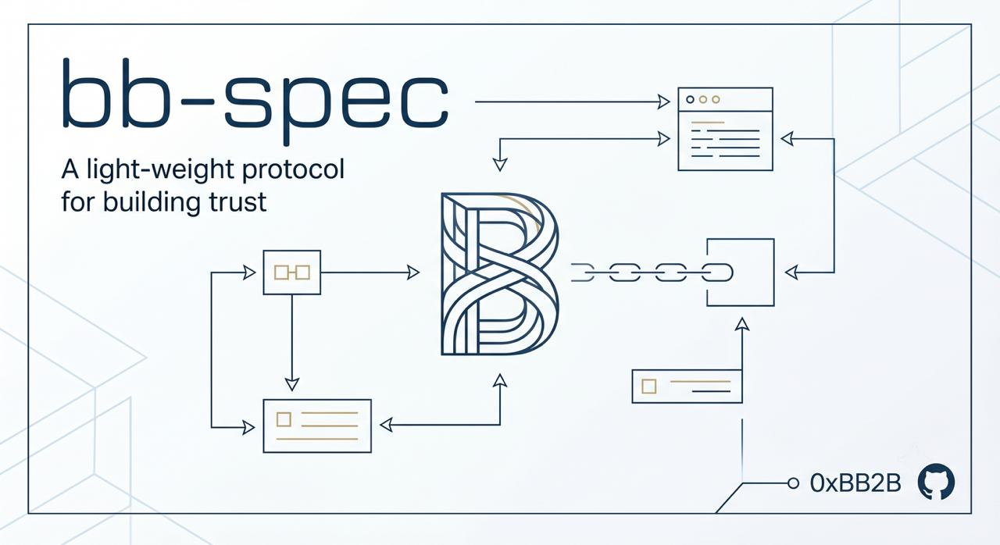

<p align="center">
  
</p>

<h1 align="center">📐 BB-Spec</h1>

<p align="center">
  <strong>A PRD-driven Claude Code pipeline that carries fuzzy requirements all the way to shipped code.</strong>
</p>

<p align="center">
  Every stage traceable, resumable, and adversarially verified — with companion stack-constraint suites for Go / Vue + bun / TDD / git discipline.
</p>

<p align="center">
  <a href="https://github.com/0xBB2B/bb-spec/actions/workflows/ci.yml?query=branch%3Amain"></a>
  <a href="https://github.com/0xBB2B/bb-spec/releases"></a>
  <a href="https://github.com/0xBB2B/bb-spec/stargazers"></a>
  <a href="LICENSE"></a>
  <a href="https://docs.anthropic.com/en/docs/claude-code/overview"></a>
</p>

<p align="center">
  <strong>English</strong> · <a href="./README.zh.md">简体中文</a> · <a href="./README.zh-TW.md">繁體中文</a> · <a href="./README.ja.md">日本語</a> · <a href="./README.ko.md">한국어</a>
</p>

<p align="center">
  <a href="#-30-second-start">Quick Start</a> ·
  <a href="#-the-prd--ship-pipeline">Pipeline</a> ·
  <a href="#-stages-at-a-glance">Stages</a> ·
  <a href="#-companion-constraint-skills">Skills</a> ·
  <a href="#-claude-code-install">Install</a> ·
  <a href="#-hooks-enabled-by-default">Hooks</a> ·
  <a href="#-prior-art--acknowledgements">Acknowledgements</a>
</p>

---

## 🚀 30-second start

```bash
/plugin marketplace add 0xBB2B/bb-spec
/plugin install bb-spec-core@0xbb2b
/plugin install bb-spec-workflow@0xbb2b
```

The 5 mainline commands:

| Command | What it does | When |
|---|---|---|
| `/prd` | Challenge → clarify → break down; after one approval, writes the PRD + AGENTS.md, then auto-runs plan → exec | New requirement |
| `/plan` | PRD → function-level implementation plan, then auto-runs exec | Auto-invoked by `/prd` |
| `/exec` | Three-agent isolated Test→Impl→Review, auto-runs doc-update at the end | Auto-invoked by `/plan`; resume manually after an interruption |
| `/review` | Parallel finders + adversarial verify | Before opening PR |
| `/git-push` | pre-review self-check + push + open PR | Ready to ship |

Three branches, callable anytime: `/git-clone` (pull a remote project locally + write `.bb-spec.yaml`, one-shot onboarding), `/revise` (route any deviation back to the right stage by root cause), `/doc-update` (doc / code consistency sweep; `/exec` and `/revise` also run it automatically over the current change at the end).

---

## 🔁 The `prd → ship` pipeline

```
 (opt) /git-clone ──► clone remote + write .bb-spec.yaml
   │
 /prd ══► /plan ══► /exec ══► /doc-update ──► /review ──► /git-push
  what      how      Red→Green  docs mirror code   finders+adv  pre-review+open PR
 (the only approval)    →Review
 ══► chained automatically, no more prompts (stops only for new third-party deps or design calls)
                                                          │
        ┌─────────────────────────────────────────────────┘
        │
        ▼ /revise (anytime, routed by root cause)
          PRD defect → edit this branch's PRD   ·   impl drift → TDD fix   ·   big requirement change → /prd

 (opt) /test-webview · /test-api — frontend / backend e2e between /exec and /review
 /doc-update (periodic / on-demand) — sweep doc / code drift → default updates docs;
                                        code violating project constraints stops to ask → routes to /revise
```

**Why this pipeline is reliable** — every handoff is a *file on disk*, not a memory in the chat. That's what makes it resumable, AI-swappable, and auditable end to end.

### 🎯 Stages at a glance

- **`/git-clone`** — *One-shot onboarding*: pull a remote repo locally and write `.bb-spec.yaml`.
  - **Two AskUserQuestion prompts**: ① single-repo vs multi-repo workspace (decides directory layout) ② `base_dir` (decides where every later bb-spec artifact lands)
  - **Multi-repo workspace**: creates a shared parent dir and clones each member repo into it (restoring the relative layout the build tool expects); refuses to nest or overwrite
  - Tightly scoped: **only** pulls code + writes `base_dir` — does not read code or install deps

- **`/prd`** — The single entry point for new requirements. Answers **"what to build, and why."**
  - Challenge first ("not worth building" is a valid outcome) → progressive clarification → breakdown, all in **plan mode for read-only alignment**; you **approve once**, then `/plan` → `/exec` → `/doc-update` run on their own
  - Writes the **PRD** (`docs/prd/<date>.<topic>/`: background, goals, non-goals, user stories, testable constraints and acceptance criteria, decision log) and **AGENTS.md** (constraints that apply to the whole project, e.g. "no generics")
  - The PRD stays editable within its branch (fix the plan mid-implementation by editing it) and freezes once merged; **code is the single source of truth for "what it does now"** — the PRD only answers "why"
  - Every later commit carries a `Requirement: <PRD dir name>` trailer: `git log -L :function:file` lists the requirements that touched a function, and the matching PRD's decision log tells you why it was built that way
  - Supports multi-repo workspaces (e.g. `docs/` and each service are separate repos): the PRD and AGENTS.md live in the docs repo, and commits in every repo carry the trailer

- **`/plan`** — PRD → self-contained, **function-level** plan. Answers **"how to build it."**
  - One independent problem per file, down to function names and responsibilities; declarative artifacts (DDL / API contracts / config) are **inlined in final form** for exec to write verbatim
  - Auto-invoked by `/prd` with no separate approval; it stops only when a **new third-party dependency** is needed, and your consent there counts as the authorization version-policy requires
  - Plans exist only while executing — `/exec` deletes them once everything is done, so they never duplicate the PRD

- **`/exec`** — **Three-agent isolated execution**, the core anti-cheat design.
  - *Test* agent reads PRD constraints only, writes failing tests (Red)
  - *Impl* agent **never sees the PRD**, only the tests + function list, so it can't quietly "teach to intent"; new third-party libs capped by the plan's approved list
  - *Review* agent checks against the PRD acceptance criteria and AGENTS.md plus a robustness/security pass, read-only
  - Progress written to `PROGRESS.md` after every step — **token-exhausted runs resume losslessly**
  - If the plan turns out to be wrong mid-implementation, it stops and lets you pick: change the code / change this PRD / pause; small changes are made in place, big ones go back to `/prd` for re-approval
  - When everything is done, auto-runs `/doc-update` in tail mode so this PRD and docs like README mirror what was actually delivered

- **`/test-webview`** — **Web-interaction acceptance** for frontend / web projects.
  - Brings the app up via the project's Docker stack (confirmed once, then remembered; `down -v` cleans up afterward), drives a real browser via the browser MCP
  - **Each case runs in an isolated serial subagent** — hundreds of cases never blow the main context; fully serial (shared single browser)
  - Cases auto-generated from the acceptance criteria and verification paths of this branch's PRD (merged, historical PRDs are not read); **coverage alignment** before a full run, gaps never silently dropped; failures route to `/revise`
  - Requires a browser MCP (playwright / chrome-devtools)

- **`/test-api`** — **API e2e** for any backend.
  - `compose.e2e.yaml` brings the stack up; md cases **mechanically render to a single-file Bun TS runner** that runs in one shot via `bun run`
  - **Zero subagents, zero concurrency** — HTTP is deterministic, clock state is shared
  - **Time-sensitive rules** (token expiry, order timeout, points expiry) tested through `/test/advance-time`, `/test/backdate`, `/test/trigger-job`
  - App side ships **two images**: test image carries `/test/*` routes + `ENV TESTAPI=1`; production image **physically excludes** `/test/*` source; `/test/healthz` probe gates the run, no fallback

- **`/review`** — Workflow-orchestrated, **adversarially verified** local PR review.
  - Phase 1 slices the diff (≤1500 lines per slice), writes each slice's diff to disk once, and fans out **3 finders per slice in parallel**: defect (security / robustness / correctness) / design (quality / simplicity / doc-sync) / **Codex cross-model independent** review, schema-enforced
  - Phase 2 **one skeptic verifier per slice** judges every 🔴/🟡 in that slice on three lenses (importance / root-cause / risk-if-unfixed), majority vote
  - Phase 3 **one sweeper per slice** hunts sibling sites of every confirmed defect class inside that slice; each class is handed to `/revise` as one fix; NITs can be cleared in one batch
  - Every phase dispatches per slice, so cost scales at ~300 tokens per diff line (a 15k-line diff ≈ 50 agents / 5M tokens)
  - Once fixes land, the fix diff gets **one automatic re-review**; the report is persisted under `.bb-spec/.cache/review/` so the next run flags recurrences and skips already-rejected items
  - Read-only — never auto-edits; requires Claude Code ≥ 2.1.154

- **`/revise`** — The exception handler, callable anytime.
  - First reads the code to confirm current behavior and traces back to the relevant PRD via `git log -L`, then classifies the deviation's **root cause** into one of three: *PRD defect*, *impl drift*, *requirement change*
  - This branch's PRD may be edited; merged PRDs are not — the reason for the fix goes into the commit body
  - Every review finding that needs fixing funnels through here
  - Auto-runs `/doc-update` in tail mode after the fix

- **`/git-push`** — User-triggered push + PR flow (single or multi-repo).
  - When AGENTS.md or a PRD on this branch exists, or this branch's commits point to a merged PRD, first runs a **branch self-check (pre-review)**: a subagent checks the branch diff against the project constraints, the PRD and the change notes in commit messages, fixes violations in a loop
  - The PR description carries the `Requirement:` trailer; the repo must allow only rebase merging (GitHub: only "Allow rebase merging", and the main-branch ruleset's "Allowed merge methods" set to Rebase only; GitLab: "Fast-forward merge" with squash set to "Do not allow"), so every commit lands on the main branch with its own `Requirement:` line
  - Drafts a **6-section PR description** (background / requirement / approach / result / tests / conventions, < 50 lines) used directly as the PR body

- **`/doc-update`** — Doc / code **consistency sweep**.
  - Four finding classes: doc-stale (root docs out of date) / prd-stale (this branch's PRD doesn't match what was delivered) / code-violation (code breaks AGENTS.md) / agents-conflict (project constraints contradict each other)
  - **Code is the truth; docs are mirrored to it**; code changes always ask first and route to `/revise` for TDD; merged PRDs are never touched in any mode
  - **Tail mode** (`--tail`): auto-invoked when `/exec` or `/revise` finishes; covers only what the current branch touched

**Ships with**

- **8 orchestration subagents** driven by the stages above: `test-engineer` / `impl-engineer` / `prd-reviewer` / `webview-test-runner` / `review-defect` / `review-design` / `review-codex` / `pre-reviewer`
- **4 passive hooks** (automatic): block npm/yarn, block main commit, dependency version self-check, Stop four-point self-check

---

## 🧩 Companion constraint skills

These feed rules into the pipeline above — install only the layers you need.

### bb-spec-core — universal discipline

- **`tdd-workflow`** — Red-Green-Refactor discipline with standard flows for the add / modify / delete scenarios
- **`version-policy`** — Standard/official libraries first — importing a new third-party library requires explicit user consent (a dependency list you consented to during `/plan` counts); check a dependency's official latest version before pinning it; never trust training memory
- **`git-workflow`** — Branch decisions, incremental commits, the six-section PR description, post-merge cleanup

### bb-spec-backend — backend stack constraints

- **`golang-constraints`** — Whole-lifecycle Go: three-layer architecture, no over-abstraction, tests subordinate to production design
- **`golang-testing`** — Go test organization: table-driven, subtests, benchmark, fuzz
- **`api-design`** — REST design: resource naming, status codes, pagination, and structured `A-BBB-CCCC` error codes
- **`database-constraints`** — App-generated UUIDv7 PKs, soft delete + composite UNIQUE, DB-managed timestamps, UTC end to end
- **`auth-constraints`** — Authentication (authN): dual-token JWT + opaque refresh with rotation & replay detection, sliding expiry, argon2id
- **`authz-constraints`** — Authorization (authZ): deny-by-default, centralized decision, two-tier role + resource-ownership checks to stop IDOR
- **`observability-constraints`** — Logs / traces / metrics on OTel: one-time assembly, structured JSON with stable trace_id, bounded label cardinality
- **`service-constraints`** — Runtime governance: env-injected secrets with fail-fast, graceful lifecycle, write idempotency, timeouts + safe retries
- **`config-constraints`** — Config carrier tiers: env/secret for startup-critical non-hot-reload, yaml/configmap for hot-reloadable defaults, DB for dynamic business config; core credentials in secret/KMS only, envelope encryption when pushed down to DB

### bb-spec-frontend — frontend stack constraints

- **`vue-constraints`** — Vue 3 + TypeScript + Vite + Tailwind + bun hard stack constraints
- **`frontend-constraints`** — Conventions: one unified request client, centralized error-code → UI mapping, UX-only route guards, types from the contract

---

## 📦 Claude Code Install

BB-Spec ships as **four independently installable sub-plugins** — install only the constraint layers you need.

First add the marketplace once, inside Claude Code:

```bash
/plugin marketplace add 0xBB2B/bb-spec
```

Then install whichever layers you want:

| Sub-plugin | What it gives you | Command |
|---|---|---|
| **bb-spec-core** _(recommended base)_ | TDD / version-policy / git-workflow discipline + 3 passive hooks | `/plugin install bb-spec-core@0xbb2b` |
| **bb-spec-workflow** _(core)_ | prd → plan → exec → doc-update → review → revise → git-push (+ opt test-webview / test-api e2e), git-clone one-shot init + 8 subagents | `/plugin install bb-spec-workflow@0xbb2b` |
| **bb-spec-backend** | Go / REST API / DB / authN / authZ / observability / service / config constraints | `/plugin install bb-spec-backend@0xbb2b` |
| **bb-spec-frontend** | Vue 3 + TS + Vite + Tailwind + bun stack & engineering conventions (+ bun hook) | `/plugin install bb-spec-frontend@0xbb2b` |

Pick by need — e.g. just the disciplines and workflow without any stack opinions: install `bb-spec-core` + `bb-spec-workflow`. Want everything: install all four.

Or add it manually to `~/.claude/settings.json` (enable only what you want):

```json
{
  "extraKnownMarketplaces": {
    "0xbb2b": {
      "source": { "source": "github", "repo": "0xBB2B/bb-spec" }
    }
  },
  "enabledPlugins": {
    "bb-spec-core@0xbb2b": true,
    "bb-spec-workflow@0xbb2b": true,
    "bb-spec-backend@0xbb2b": false,
    "bb-spec-frontend@0xbb2b": false
  }
}
```

## 🔄 Versioning

```bash
claude plugin update bb-spec-workflow@0xbb2b   # update one sub-plugin from your terminal
```

To update all of them at once: run `/plugin` in a session, open the **Marketplaces** tab, select `0xbb2b`, then choose **Update marketplace**.

The four sub-plugins share a single synchronized version line.

### Upgrading from 13 or earlier

No migration is needed. Delete or keep the old `.bb-spec/` directory in your project — either way, start your next requirement with `/prd` right after upgrading.

If you keep the old directory (`.bb-spec/docs/` below is the default location; if you changed `base_dir` in `.bb-spec.yaml`, use yours):

- The old `.bb-spec/docs/spec/`, `.bb-spec/docs/prd/.archive/` and `.bb-spec/docs/plan/INDEX.md` are never read or modified.
- Until `.bb-spec/docs/prd/GLOSSARY.md` exists, `/prd` uses the terms in `.bb-spec/docs/spec/GLOSSARY.md`; the first time it records a term, it copies the whole table to the new location and leaves the old one untouched.
- Plans left unfinished under 13 can't be resumed — start again with `/prd`. Once you no longer need them, remove `plan/INDEX.md` and the topic directories it lists with `git rm -r`.

Code written before you adopted bb-spec has no `Requirement:` marker in its commits, so there is no PRD to look up. When you fix it with `/revise`, the expected behavior you describe is the reference.

Two things outside `.bb-spec/` need manual action:

1. If you installed `bb-spec-product`, uninstall it with `/plugin uninstall bb-spec-product@0xbb2b`. `/prd` now lives in `bb-spec-workflow`.
2. If you copied the old `CLAUDE.template.md` into a CLAUDE.md (global `~/.claude/CLAUDE.md` or the project root), change item 4 of "任务分流" (task routing) from `/spec → /plan → /exec` to `/prd`, and in item 3 change "有现成 spec/plan/代码可对照" (existing spec/plan/code to compare against) to "有现成 PRD 或代码可对照" (existing PRD or code to compare against).

---

## 🪝 Hooks enabled by default

Each hook ships with the sub-plugin that owns its concern — install that plugin to get it.

| Hook | Sub-plugin | Trigger | Effect |
|---|---|---|---|
| `block-non-bun-pm` | bb-spec-frontend | PreToolUse(Bash) | Blocks `npm` / `yarn` / `pnpm` package-manager actions, enforcing `bun`; existing projects with a matching lockfile (e.g. `package-lock.json`) are allowed through |
| `git-workflow-guard` | bb-spec-core | PreToolUse(Bash) | Blocks `git commit` on `main` / `master`; for other git flow actions (branch / push / worktree / merge / PR) allows them through and injects the git-workflow discipline plus live git status |
| `dep-version-check` | bb-spec-core | PostToolUse(Write\|Edit) | After editing a dependency file, injects a "check the official latest version first" reminder |
---

## 🧪 Tests

```bash
bash tests/validate.sh
```

Validates the multi-plugin structure: marketplace.json validity and plugin-entry consistency (every `source` resolves to a real plugin dir whose name matches), each sub-plugin's plugin.json fields, agent frontmatter integrity (required fields, name consistency, valid agent-type values, security-baseline section), skill SKILL.md format, hooks.json validity and script existence, and personal-path leak detection.

CI runs automatically on PRs and pushes to main (`.github/workflows/ci.yml`).

---

## 🛠️ Recommended companions

### AGENTS.md: project constraints and lookup rules

`/prd` writes constraints that apply to the whole project (e.g. "no generics", "SQL joins span at most 3 tables") into `AGENTS.md` at the project root, and constraints that belong to a single feature into the PRD — no constraint is written in two places. `AGENTS.md` also has a "how to look up features and issues" section: any answer about "what the system does now" must come from code actually read, with `file:line`; for "why", use `git log -L` to find the requirements that touched the function, then read the PRD; when the PRD and the code disagree, the code wins. Claude Code reads `CLAUDE.md` but not `AGENTS.md` directly, so `/prd` makes sure the project-root `CLAUDE.md` contains an `@AGENTS.md` line to import it.

### .bb-spec.yaml project config

`/prd` and `/plan` output under `.bb-spec/docs/` by default (`.bb-spec/docs/prd/`, `…/plan/`); runtime transient artifacts (e.g. webview screenshots) go to the sibling `.bb-spec/.cache/` (auto-gitignored). Create a `.bb-spec.yaml` in the project root to override the bb-spec root directory:

```yaml
base_dir: my/bb  # → my/bb/docs/{prd,plan,test}/ and my/bb/.cache/ ; use ./ to place them at the project root
```

Reference template: [`.bb-spec.template.yaml`](./.bb-spec.template.yaml).

---

## ⚙️ Hook switch cheat sheet

| Scenario | Switch |
|---|---|
| Temporarily allow npm / yarn / pnpm | Disable `bb-spec-frontend` temporarily |
| Temporarily allow main commit | Disable `bb-spec-core` temporarily |
| Skip the Stop self-check | No switch — this is a core iron rule, skipping is discouraged |

---

## 💡 Prior art & acknowledgements

BB-Spec stands on three excellent projects. Each shaped a different part of its design — credited below, alongside what BB-Spec borrowed and how it pushed the idea further.

| Project | What it does best | What BB-Spec borrowed & hardened |
|---|---|---|
| [**Superpowers**](https://github.com/obra/Superpowers) (obra) — a complete coding-agent methodology | End-to-end staged workflow, subagent-driven development with phased review, TDD Red-Green-Refactor, git-worktree isolation, Socratic brainstorming, a composable skill library | The whole `prd → ship` pipeline backbone, splitting work across role-specialized subagents, mandatory TDD, multi-stage / adversarial review, and dialogue-first requirement clarification |
| [**ECC**](https://github.com/affaan-m/ECC) (affaan-m) — an agent-harness "operating system" | A large layered system of agents / skills / hooks / rules, passive hooks that auto-enforce, rules-as-infrastructure, memory persistence across sessions | The layered, independently-installable sub-plugin suite, passive hooks that enforce discipline, and distilling engineering conventions into loadable constraint skills |
| [**skills**](https://github.com/mattpocock/skills) (mattpocock) — "Skills For Real Engineers" | Targets real failure modes (misalignment / verbosity / quality / architecture), deep questioning to align on intent, shared domain language, user- vs model-invoked skills, vertical slicing | Challenge-first dialogue to pin down requirements before any code, dual-trigger skills (slash command + model auto-trigger), and the single-source-of-truth minimalism |

**Where BB-Spec goes its own way** — differentiators none of the three combine:

- **Three-agent isolated execution** — the Impl agent *physically never sees the PRD*, only the tests, so it cannot quietly "teach to intent"; tests, implementation, and review are written by mutually-blind agents.
- **Disk documents as the only handoff** — every stage hands off a file, not chat memory, so a run resumes losslessly across sessions, `/clear`, or even a different model picking up the work.
- **Code ⇄ PRD, traceable both ways through git** — code is the single source of truth and the PRD only records why; every commit carries a requirement trailer, so you can go from a feature to its code and from a function back to the requirement and trade-offs behind it, with no hand-synced rule documents in between to go stale.

---

## 📜 License

MIT — see [LICENSE](./LICENSE).

<p align="center">
  <sub>Built with ❤️ for the Claude Code community.</sub>
</p>
